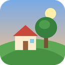

# Animal Crossing Port for WebOS TVs



A native LG webOS TV build of the Animal Crossing (GameCube) decompilation,
running on the TV's own GPU through OpenGL ES 3. You need your own copy of the
game: no game data is included.

> **Status: early.** Version 0.1.0 compiles and packages for the TV; it has
> not been played on a TV yet. The file-transfer page, remote control mapping
> and TV menu are still to come (see [Roadmap](#roadmap)).

## How it works

This project does not change the game code. It builds the
[ACGC Android port](https://github.com/zwaetschge/ACGC-Android-Port)
(the [PC port](https://github.com/flyngmt/ACGC-PC-Port) of
[ac-decomp](https://github.com/ACreTeam/ac-decomp) plus an OpenGL ES 3
renderer path) for webOS, with a small webOS layer in `src/webos/`:

| File | What it does |
|---|---|
| `webos_glue.c` | Picks the data folder, creates `rom/`, `save/`, `texture_pack/`, links the shaders, writes logs; rewrites the desktop GLSL 3.30 shaders to GLSL ES 3.00 before compiling them |
| `glad/gl.h` | Replaces the desktop GL loader: maps the few desktop-only GL calls to ES ones |
| `webos_forced_decls.h`, `webos_bstring.c` | Reconcile the decomp's own libc declarations with the TV's glibc |
| `cmake/GlesLinkStub.cmake` | The toolchain only ships OpenGL ES 2 libraries; the game links against a stub with the ES 3 entry points and uses the TV's real driver at run time |

The TV requirements were checked first with
[ES3-WebOS-probe](https://github.com/pustal/ES3-WebOS-probe): webOS 6 Mali
drivers expose OpenGL ES 3.2, and the port's specialised shaders render a
frame in about 16 ms at 1080p.

## Installing

1. Install `dist/org.animalcrossingwebos.app_<version>_arm.ipk` with
   [webOS Dev Manager](https://github.com/webosbrew/dev-manager-desktop) or
   `ares-install`.
2. Start the app once. It creates its data folder (`$HOME/data` of the app)
   with these subfolders:

   ```
   rom/            put GAFE01.iso here (the US disc image)
   save/card_a/    memory card A (GCI saves)
   save/card_b/
   texture_pack/   optional custom textures
   stdout.log, stderr.log, settings.ini
   ```

3. Until the transfer page exists, copy the disc image over SSH (rooted TV).
   Find the folder with `find / -name stdout.log -path "*animalcrossing*" 2>/dev/null`,
   then `scp GAFE01.iso root@<tv>:<that folder>/rom/`.

## Building

You need Linux x86_64 (or a Linux VM/container on macOS), the webosbrew
toolchain ([buildroot-nc4 releases](https://github.com/openlgtv/buildroot-nc4/releases),
run its `relocate-sdk.sh` once), CMake 3.21+, Python 3 and
`ares-package` (`npm install -g @webos-tools/cli`).

```sh
git submodule update --init
export WEBOS_SDK=$HOME/arm-webos-linux-gnueabi_sdk-buildroot
scripts/build-webos.sh
```

The IPK and its Homebrew Channel manifest land in `dist/`. The first build
downloads the SDL-webOS release it bundles.

## Roadmap

- Transfer page in the browser (upload the disc image and saves), on its own port
- USB drive support: report free space, load `Animal Crossing/texture_pack/` from it
- TV remote mapping and a light Back menu (a game controller is recommended)
- Shader cache on disk, internal resolution setting, CPU load check

## Credits

- [ACreTeam/ac-decomp](https://github.com/ACreTeam/ac-decomp): the decompilation (CC0)
- [flyngmt/ACGC-PC-Port](https://github.com/flyngmt/ACGC-PC-Port): the PC port (MIT)
- [zwaetschge/ACGC-Android-Port](https://github.com/zwaetschge/ACGC-Android-Port): the OpenGL ES 3 / mobile path this build uses
- [webosbrew](https://www.webosbrew.org/): toolchain, SDL-webOS and the Homebrew Channel

See [THIRD_PARTY_NOTICES.md](THIRD_PARTY_NOTICES.md). Animal Crossing is a
trademark of Nintendo. This project is not affiliated with or endorsed by
Nintendo.

## Licence

MIT (see [LICENSE](LICENSE)) for the code in this repository.
